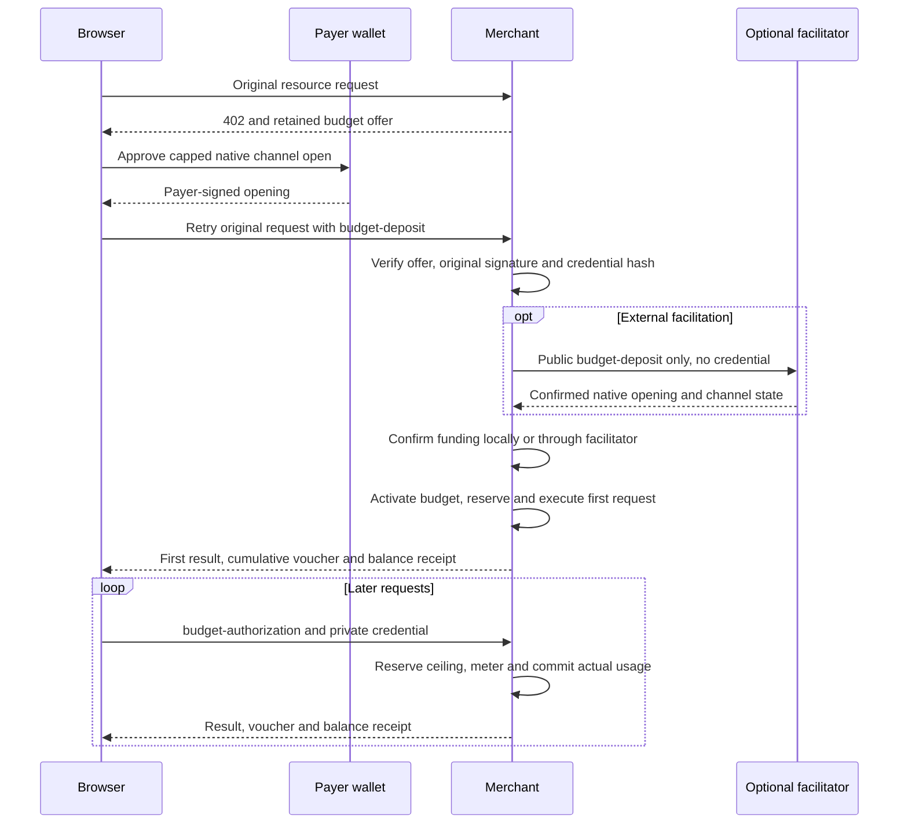
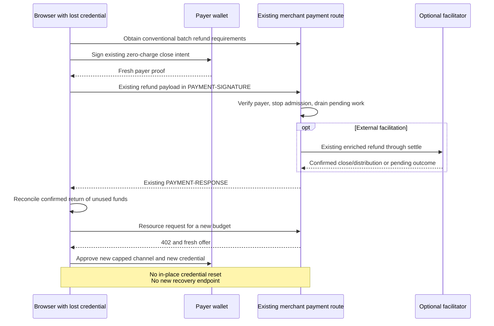

# Proposal: SVM conversation-budget authorization v1

## Summary

A browser user approves a spending budget once, such as $5 USDC for a chat.
A dedicated payment channel holds that amount. Later requests use a private
conversation credential, and the merchant records actual usage and signs the
existing cumulative vouchers. If the credential is lost, the user authorizes
the existing refund flow with their payer wallet, then approves a new channel.

**Status: draft for protocol review, not an implemented or deployed feature.**
This proposal extends the [SVM batch-settlement binding](scheme_batch_settlement_svm.md).
It specifies authorization and close-and-reopen recovery together. Credential
replacement, credential generations and recovery-specific endpoints are outside
v1. No change to the payment-channel program or voucher encoding is proposed.

## 1. Scope and negotiation

The scheme remains `batch-settlement`, using x402 v2 and the existing HTTP
`PAYMENT-REQUIRED`, `PAYMENT-SIGNATURE` and `PAYMENT-RESPONSE` headers. This is a
scheme-specific authorization mode, not a new generic `extensions` registration.
Unselected legacy client/server-signed behavior remains unchanged.

Proposed capability and requirement fields:

| Location | Field | Meaning |
| --- | --- | --- |
| Facilitator `/supported` extra | `authorizationModes` | Includes `"conversation-budget-v1"` only when its budget-opening path is supported. |
| Merchant payment requirements extra | `authorizationMode` | Exactly `"conversation-budget-v1"` selects this proposal. Absence selects existing behavior. |
| Same requirements extra | `voucherSigner`, `operator` | MUST select `"server"` and identify the trusted operator, as in existing server mode. |
| Same requirements extra | `paymentFlow` | MUST be `"escrow"` for budget-funded resource requests. |
| Merchant 402 `accepts[i].extra` | `budgetOffer` | A retained, single-use offer as defined below; not authority merely because a client echoes it. |

All three roles MUST support the selected mode. Unknown modes, mismatched
signer/flow combinations and unsupported capabilities MUST fail closed. A client
MUST NOT silently downgrade a failed budget request to another authorization.
Existing operator-trust and local spending-limit checks still apply. Selecting
the escrow flow is explicit user/client policy; the general preference for
post-handler authorization does not constitute consent to a conversation budget.

The merchant MUST also advertise a conventional server-signed batch accept on
the same protected route for `refund`, with the same network, asset, receiver,
operator, sponsor, receiver authorizer and withdrawal delay. That accept omits
`authorizationMode` and uses the existing `authorization` flow. Refund clients
MUST select that advertised accept rather than reusing the budget escrow accept.
This keeps refunds in the existing verify/skip-handler/settle control path.
It does not permit legacy paid requests to bypass an existing budget's limits.

For example, the decoded `PAYMENT-REQUIRED` object advertises both accepts:

```json
{
  "x402Version": 2,
  "resource": { "url": "https://merchant.example/chat", "mimeType": "application/json" },
  "accepts": [
    {
      "scheme": "batch-settlement",
      "network": "solana:EtWTRABZaYq6iMfeYKouRu166VU2xqa1",
      "asset": "<base58 mint>",
      "payTo": "<base58 merchant receiver>",
      "amount": "1000000",
      "maxTimeoutSeconds": 60,
      "extra": {
        "authorizationMode": "conversation-budget-v1",
        "paymentFlow": "escrow",
        "voucherSigner": "server",
        "operator": "<base58 operator>",
        "feePayer": "<base58 sponsor>",
        "receiverAuthorizer": "<base58 receiver authorizer>",
        "withdrawDelay": 900,
        "tokenProgram": "TokenkegQfeZyiNwAJbNbGKPFXCWuBvf9Ss623VQ5DA",
        "budgetOffer": {
          "version": 1,
          "id": "0123456789abcdef0123456789abcdef",
          "audience": "https://merchant.example",
          "maximumAmount": "5000000",
          "expiresAt": 1800000600
        }
      }
    },
    {
      "scheme": "batch-settlement",
      "network": "solana:EtWTRABZaYq6iMfeYKouRu166VU2xqa1",
      "asset": "<base58 mint>",
      "payTo": "<base58 merchant receiver>",
      "amount": "1000000",
      "maxTimeoutSeconds": 60,
      "extra": {
        "paymentFlow": "authorization",
        "voucherSigner": "server",
        "operator": "<base58 operator>",
        "feePayer": "<base58 sponsor>",
        "receiverAuthorizer": "<base58 receiver authorizer>",
        "withdrawDelay": 900,
        "tokenProgram": "TokenkegQfeZyiNwAJbNbGKPFXCWuBvf9Ss623VQ5DA"
      }
    }
  ]
}
```

Clients communicate with the merchant. Capability discovery, funding, claims
and refunds are performed by the merchant or its configured facilitator. A
self-facilitating merchant exposes the same client interface. No facilitator
URL, direct facilitator call or separate budget-setup endpoint is required.
Existing trusted RPC and mint-owner validation requirements are unchanged.
Absence of the facilitator capability means this mode is unsupported; the
merchant MUST NOT advertise it in that configuration.

## 2. One channel, one approved budget

V1 requires a fresh, otherwise-unused channel whose deposit equals the approved
maximum. An existing larger channel cannot be treated as an equally protected
smaller budget. Top-ups, extension of expiry, multi-merchant budgets and in-place
credential replacement are outside this version.

The merchant retains an offer before wallet approval:

| `budgetOffer` field | Rule |
| --- | --- |
| `version` | Exactly `1`. |
| `id` | Merchant-generated unpredictable 16 bytes, encoded as 32 lowercase hex characters. Single use across its funding attempts/channels. |
| `audience` | Canonical HTTPS merchant origin, without a path, credentials or fragment. |
| `maximumAmount` | Positive canonical decimal u64 atomic amount, at least the first request's quoted ceiling. |
| `expiresAt` | Positive safe-integer Unix seconds, within the merchant's configured budget lifetime. |

The offer is also bound to the route's network, asset, receiver, operator,
sponsor, receiver authorizer and withdrawal delay. The merchant MUST retain
these bindings and the application/request context; it MUST NOT adopt a
client-supplied offer after state loss. A route may attach a new offer to its
402 response while retaining previous offers for their pending attempts.

The initial ordinary resource request need not already identify a payer or
credential hash. The browser adds those client-controlled fields when building
the payer-signed open. They are accepted only under the retained offer and the
native transaction's exact signature and bindings. Implementations MAY use
application hints to choose a quoted budget; hints are not authorization.

The client generates an unpredictable 32-byte private credential, encoded as
exactly 64 lowercase hex characters, fresh for each budget. `credentialHash` is
lowercase hex SHA-256 of the ASCII credential string. Only the hash is public.
The merchant stores the hash and grant; it MUST NOT persist the raw credential.

Before approval, the user MUST see the funding amount/asset, expiry, merchant,
operator trust and how to stop/refund. Budget expiry is distinct from the HTTP
`maxTimeoutSeconds`. Both expiry and Stop are merchant admission policy, not
revocation of the operator's existing onchain authority over the deposit.

## 3. Opening commitment and payload

Use the existing canonical open instruction, recipient distribution and
receiver-authorizer binding Memo. The opening's `payerAuthorizer` is the
advertised operator and `voucherSigner` is `"server"`. Preserve existing
signer/account/instruction allowlists, mint owner, transaction-version, slot,
compute/fee and sponsor checks. The program ID remains the network constant.

The budget opening uses the seller-reference Memo slot for the canonical Memo
below; it MUST NOT append an additional instruction outside the existing
allowlist. If a seller reference is required, its exact UTF-8 value is committed
inside the terms digest. A client MUST NOT append or substitute a second seller
Memo. The separate receiver-authorizer binding Memo remains unchanged.

Full terms are encoded as these exact ASCII lines, in this order, with LF
separators and no trailing newline:

```text
x402-batch-budget-terms-v1
Budget ID: <offer.id>
Network: <accepted.network>
Audience: <offer.audience>
Payer: <channelConfig.payer>
Operator: <accepted.extra.operator>
Receiver: <channelConfig.receiver>
Receiver authorizer: <channelConfig.receiverAuthorizer>
Sponsor: <accepted.extra.feePayer>
Asset: <channelConfig.token>
Token program: <accepted.extra.tokenProgram>
Maximum amount (atomic units): <offer.maximumAmount>
Expires at (Unix seconds): <offer.expiresAt>
Credential SHA-256: <credentialHash>
Salt: <channelConfig.salt>
Open slot: <channelConfig.openSlot>
Withdrawal delay (seconds): <channelConfig.withdrawDelay>
Seller memo SHA-256: <sellerMemoHash>
```

Addresses MUST decode to 32 bytes; numbers use canonical unsigned decimal with
no sign or leading zeroes except `0` where the existing field allows it.
`expiresAt` is positive; `openSlot` fits the client's safe integer range. The
audience MUST be its ASCII serialized HTTPS origin and match trusted merchant
configuration, not a request's untrusted Host header. The hash fields have
exactly 64 lowercase hex characters. Unknown or additional terms are rejected;
no trimming or Unicode/line-ending normalization is allowed.

`sellerMemoHash` is lowercase hex SHA-256 of UTF-8 `accepted.extra.memo`, treating
absence as the empty string. The digest is always 64 hex characters; for absence
or an empty reference it is exactly
`e3b0c44298fc1c149afbf4c8996fb92427ae41e4649b934ca495991b7852b855`.

Let `termsHash` be unpadded base64url of SHA-256 of those bytes. The actual Memo
is compact, ASCII, LF-separated and has no trailing newline:

```text
x402-batch-budget-v1
Budget: <offer.id>
Cap: <offer.maximumAmount>
Expires: <offer.expiresAt>
Terms: <termsHash>
```

It MUST fit the existing 256-byte Memo limit. The full terms digest binds the
credential, audience, network and native channel configuration without putting
the secret onchain. Native instructions independently bind the actual escrow,
operator and receiver. Clients and facilitators reconstruct both encodings;
wallet-returned display text is not a substitute for verified original bytes.

The browser retries the original request with this new payload variant in
`PAYMENT-SIGNATURE`; its `accepted` is the selected budget accept:

```json
{
  "type": "budget-deposit",
  "channelConfig": {
    "payer": "<base58 payer>",
    "payerAuthorizer": "<base58 operator>",
    "receiver": "<base58 merchant receiver>",
    "receiverAuthorizer": "<base58 receiver authorizer>",
    "token": "<base58 mint>",
    "withdrawDelay": 900,
    "salt": "42",
    "openSlot": 341000000,
    "voucherSigner": "server"
  },
  "budget": {
    "version": 1,
    "id": "<retained offer ID>",
    "audience": "https://merchant.example",
    "maximumAmount": "5000000",
    "expiresAt": 1800000600,
    "credentialHash": "<64 lowercase hex characters>"
  },
  "requestId": "<fresh operation ID>",
  "credential": "<private 64-character hex credential>",
  "deposit": {
    "amount": "5000000",
    "transaction": "<base64 payer-signed open>"
  }
}
```

The address placeholders stand for the existing validated 32-byte Base58 keys.
No legacy single-request payer proof is synthesized. `deposit.amount` MUST equal `budget.maximumAmount`; the first
request's charge ceiling is still `accepted.amount`, not the full deposit.

## 4. First request and repeated requests

The successful first resource uses one ordinary 402 challenge and one signed
retry. A fresh opening and credential approval are carried by the same native
transaction; no additional message signature or registration round trip is
required. Wallet transaction previews and popup counts require validation.



The merchant MUST validate the retained offer, payer signature, exact Memo,
credential hash and request context before submitting funding. It atomically
binds the offer to one channel and one transaction-message fingerprint before
broadcast; duplicate submissions reconcile that attempt. A different payer,
channel or message cannot race an in-flight attempt into a second active grant.
Unsigned preparation or a valid payer signature is not proof of funding.

Budget resource requirements explicitly select the existing core `escrow`
ordering: before-handler funding/reservation, resource, after-handler actual
commitment, response. Legacy batch requirements keep their `authorization`
ordering. `/verify` remains read-only and MUST NOT broadcast an open.

For a new channel, the merchant's before-handler settle submits only the public
budget/deposit/configuration to the configured facilitator, or self-facilitates.
The private credential MUST be removed before forwarding and MUST NOT reach
facilitator logs, traces or transaction metadata. The facilitator's
`budget-deposit` input contains the public fields above but no `credential`;
the merchant constructs it from a validated public-field allowlist rather than
forwarding the original header object or request body.
The facilitator validates the digest/native envelope, sponsors and confirms the open.
The signed Memo commits the public hash, so the facilitator need not know its
preimage. Only this funding variant is a facilitator budget-operation input.

After trusted confirmation, the merchant verifies the actual channel, successful
transaction, inclusion slot, sponsor signature, deposit equality, settled zero,
roles and retained bindings, then activates and reserves the first request.
Expired or canceled attempts MUST NOT activate spending. A late confirmed open
still needs a retained, wallet-refundable channel record; do not discard funds
or report that no deposit exists merely because admission was canceled. Retain
zero spending/reservations and the correct funded deposit for such an unused
channel; refund preparation uses the existing zero-cumulative operator-voucher
case, not a fabricated charge. No operator voucher advances an equal onchain
watermark unnecessarily.

The first request's after-handler settle is merchant-local too: it commits the
actual charge and ordinary cumulative operator voucher, rather than posting a
second opening or forwarding the private credential to the facilitator.

Later requests carry:

```json
{
  "type": "budget-authorization",
  "channelConfig": {
    "payer": "<base58 payer>",
    "payerAuthorizer": "<base58 operator>",
    "receiver": "<base58 merchant receiver>",
    "receiverAuthorizer": "<base58 receiver authorizer>",
    "token": "<base58 mint>",
    "withdrawDelay": 900,
    "salt": "42",
    "openSlot": 341000000,
    "voucherSigner": "server"
  },
  "budgetId": "<original offer ID>",
  "requestId": "<fresh operation ID>",
  "credential": "<private 64-character hex credential>"
}
```

The merchant verifies the original grant and current route requirements.
`accepted.amount` is the quoted per-request ceiling. Echoed offers/extra fields
MUST NOT redefine grant authority; current route pricing and the retained grant
must both be satisfied. A client obtains fresh requirements if pricing changed.

For an already-funded channel, the before-handler and after-handler settles
are durable merchant-ledger operations: reserve the ceiling, then commit the
actual charge and ordinary operator voucher. They do not require forwarding
the credential or an HTTP `/settle` call to an external facilitator. Periodic
redemption continues using the existing server-authenticated claim/voucher path.
The facilitator MUST NOT accept `budget-authorization` as a direct payer proof.

The merchant MUST authenticate and reserve atomically, requiring:

```text
spent + reserved + next request ceiling <= approved maximum
```

Each request ID is 1–256 UTF-8 bytes and binds the channel, request fingerprint,
quote, reservation and terminal outcome. Conflicting reuse MUST fail. Identical
retries MUST NOT repeat work or charges: return a durable status/receipt or a
duplicate/pending outcome. A stored application result requires application-level
idempotency as well; a payment receipt alone cannot recreate an AI response.

After metering, commit actual cost `0 <= actual <= reserved ceiling`, the request
outcome, cumulative amount and unchanged operator voucher atomically. Signing
outside the database transaction requires a spending-revision check/retry.
Release unused reserved capacity in the same commit. Failed/timed-out work does
not by itself establish a terminal outcome. Preserve ambiguous reservations
until reconciled. A confirmed failed or canceled resource follows the existing
no-charge policy: release its reservation without advancing the voucher. Costs
incurred by an external provider do not alone authorize charging a failed
resource request. A lost HTTP response is not proof that the handler failed.

Funding remains durable if the first handler fails after the opening confirms.
Preserve its channel/grant and expose or reconcile the funding transaction and
budget identity on the error path. Do not fund another channel merely because
the resource result failed or was lost; existing refund access remains available.

`PAYMENT-RESPONSE` retains the existing commitment/actual-charge/voucher fields
and adds proposed `extra.budget` with `id`, `maximumAmount`, `expiresAt`, `spent`,
`reserved`, `available` and admission `status`. Amounts are canonical atomic
strings, and `available = maximumAmount - spent - reserved`. The response MUST
distinguish merchant acceptance from later onchain redemption. The client
verifies operator vouchers and never treats the full deposit as the first charge.

Admission `status` is one of `"funding-pending"`, `"active"`, `"stopped"`,
`"expired"`, `"closing"`, or `"closed"`. These are merchant lifecycle states,
separate from the native channel status. `active` requires confirmed funding,
an unexpired, unstopped grant and a usable native channel. `closing` means the
merchant has stopped admission to reconcile/close, not necessarily that an
onchain `request_close` has landed. `closed` requires confirmed finalization.
No pending/expired/stopped/closing state authorizes new paid work.

## 5. Recovery uses the existing refund flow

There is no new `/recover`, `/reset`, challenge or credential-replacement
endpoint in v1. The client calls the merchant's existing batch payment/refund
route with the existing `type: "refund"` payload in `PAYMENT-SIGNATURE`.
It selects the advertised conventional server-signed `authorization` accept,
not the budget `escrow` accept. The upstream TypeScript helper shape is
`batch.refund(protectedRouteUrl)`; client selection must choose that compatible
accept (explicit requirements may be supplied). The helper currently uses GET
for probing and refund submission. POST-only applications must provide compatible
GET payment routing or an equivalent method-aware client binding; they need
no new recovery-specific route. This transport integration is not implemented
by this proposal.

The normal server-mode refund remains:

1. The **actual payer wallet** signs a fresh existing `BatchAuthorization` with
   `authorizedAmount: "0"`, a fresh request ID and normal proof expiry.
   The private conversation credential MUST NOT be required, even if lost,
   the budget expired or the merchant previously stopped it. Zero is close
   intent, not the amount returned. The channel still has to be identified.
2. The merchant verifies that proof against the immutable channel payer and
   existing operator/receiver bindings. It bypasses the paid handler, stops new
   admission and serializes close against all authorized pending work. Pending
   charges must finish or be reconciled before the final accepted voucher is used.
   An unauthenticated probe MUST NOT stop a budget.
3. The merchant injects its stored final operator voucher and existing
   receiver-authorizer `CloseAuthorization`; it does not trust a payer-supplied
   voucher in server mode. It submits the existing enriched `refund` to its
   facilitator's `/settle`, or performs the same work locally.
4. The existing cooperative `settle_and_seal` plus sealed `distribute` pays the
   final accepted charges and returns the remaining escrow to the payer. Keep
   the existing receiver-binding, delegated-authorizer, simulation and retry rules.
5. A pending/ambiguous response is reconciled by transaction and channel state;
   only confirmed distribution establishes the refund. Repeat requests MUST NOT
   duplicate close, payout, or paid work. Retain the terminal channel record.

The merchant MUST retain compatible refund requirements and control handling
for live budget channels even after their offer expires, new budget admission
is disabled, or current route configuration changes. Exit authorization is
bound to the channel's original payer/operator/receiver bindings; it MUST NOT
require a newly issued budget offer or restore spending access first.

The existing refund-proof encoding rules apply. This proposal does not introduce
a new recovery message or merge the separate readable-proof proposal. A wallet
unable to sign the existing binary refund proof needs a separately supported,
negotiated readable format for cooperative HTTP recovery. The existing sponsored
HTTP `request_close` fallback still requires server-mode payer proof; it is not
a bypass of that signature requirement. If merchant-mediated signing/cooperation
is unavailable, the payer's independent onchain `request_close` remains the
escape path, followed by the grace-period seal/withdraw/distribute lifecycle.
It requires chain access and fees/sponsorship and can allow final operator claims
up to the deposit during grace. It does not promise an immediate or trustless refund.

After **confirmed** return of funds, the user may approve a fresh channel through
the same 402/open flow, with a new offer, channel and credential. Old proof or
credential cannot authorize it. Do not silently restore the original spending
allowance or extend expiry: after $1.75 spent from $5, default continuation is at
most the confirmed $3.25 remainder under the original still-valid expiry.
A larger cap or later expiry requires clear new approval. Application-level
idempotency survives channel migration, so an old paid operation is not rerun
merely because the channel changed. Opening before an unresolved refund is a
separate explicit funding decision, not automatic recovery.



## 6. Durable state and threat boundaries

- Store offer consumption/funding-attempt bindings, immutable grant/hash,
  channel identity, spending, reservations, operation outcomes and latest voucher
  in one durable accounting boundary. Registration/retry never resets spending.
- Stop or expiry blocks **new** work. Already-authorized charges remain reserved
  until reconciled. A close requires fresh chain/lifecycle checks and must not
  race a still-running charge. An alternate legacy accept cannot bypass these
  rules for a channel tagged as a budget channel.
- Missing/rolled-back ledgers MUST hold admission and reconcile from retained
  records or close. Public funding data or the onchain settled watermark cannot
  recreate unclaimed offchain charges. Backup restores need an external admission
  gate; this proposal does not solve full coherent rollback from the same store.
- Only the intended merchant receives the bearer over authenticated HTTPS. Never
  put it in URLs, onchain, facilitator requests, logs, analytics, model/tool inputs
  or unrelated redirects. HTTP caches must not reuse paid results across bearers.
  Use cryptographic randomness, constant-time hash comparison, secure browser
  sessions, origin/CSRF controls where applicable and request/quote limits.
- A stolen credential can consume the remaining budget. Expiry, Stop and honest
  accounting bound admission; the onchain operator can still claim its full
  deposit. Credential loss is distinct from loss of the payer wallet key.
- Preserve trusted fresh channel reads, periodic claims inside `maxIdleSecs`,
  settlement workers and forced-close/grace handling. An idle-close can forfeit
  unclaimed charges; do not accept work against a closed channel.

Proposed mode-specific invalid reasons are `invalid_batch_settlement_svm_budget_mode`,
`invalid_batch_settlement_svm_budget_offer`, `invalid_batch_settlement_svm_budget_credential`,
`invalid_batch_settlement_svm_budget_expired`, `invalid_batch_settlement_svm_budget_stopped`,
`invalid_batch_settlement_svm_budget_exhausted`, and `invalid_batch_settlement_svm_budget_state`.
Keep existing invalid transaction/refund/replay reasons and `settlement_pending`
semantics; no error implies that a broadcast failed or funds were refunded.

## 7. Acceptance matrix and review questions

Before implementation is enabled, require conformance coverage for:

| Case | Required result |
| --- | --- |
| One opening approval and original request retry | Funding confirmed before paid work; first usage charged once. |
| Public offer/transaction/hash only; wrong secret/origin/channel/operator | Reject; cannot start paid work. |
| Unknown mode or unsupported flow | Reject before signing/funding; no silent legacy downgrade. |
| Changed terms/Memo/deposit/sponsor/payer, reused offer | Reject before broadcast or reconcile the already-bound attempt. |
| Concurrent reservations and completions | No cap overspend, missing charges or stale voucher commits. |
| Same request retried after response loss/restart | No second work execution/charge; durable outcome or explicit reconciliation. |
| Funding lands after cancellation/expiry | No new spending; preserve wallet-authenticated refund access. |
| Credential lost, stopped or expired budget | Existing payer-authenticated refund works without the bearer. |
| Refund presented under budget escrow accept | Reject without funding; select the advertised conventional refund accept. |
| Partial or ambiguous close/forced close | Correct pending/grace status; never claim an unconfirmed refund. |
| Reopen after refund | Fresh explicit approval/credential; old ledger and application outcomes remain consumed. |
| External and self-facilitating merchants | Same browser contract; no direct facilitator calls. |
| Ledger loss/restore, idle close, late completion | Hold admission and reconcile; never reset to zero spending. |
| MetaMask, Phantom, Solflare | Verify exact native transaction and refund-proof compatibility; no assumed popup count. |

Review requested on: the authorization/flow negotiation, paired conventional
refund accept, compact commitment, initial retained-offer binding, and whether
this should remain a separate binding supplement or move into the parent file.
Field names are proposed, not a released API. No implementation, dependency,
deployment or onchain-program change is included in this spec-only proposal.

## Appendix A. Non-payment serialization vector

These fixed synthetic public-key bytes are a serialization fixture, not a valid
funding request or a wallet-compatibility test. The credential hash below uses a
fixed public test input (64 ASCII zero characters); real credentials MUST be
fresh and unpredictable. No private payer key or funded channel is involved.
The seller memo is absent. Each fenced message excludes its final display newline.

Full terms:

```text
x402-batch-budget-terms-v1
Budget ID: 0123456789abcdef0123456789abcdef
Network: solana:EtWTRABZaYq6iMfeYKouRu166VU2xqa1
Audience: https://merchant.example
Payer: 4vJ9JU1bJJE96FWSJKvHsmmFADCg4gpZQff4P3bkLKi
Operator: 8qbHbw2BbbTHBW1sbeqakYXVKRQM8Ne7pLK7m6CVfeR
Receiver: CktRuQ2mttgRGkXJtyksdKHjUdc2C4TgDzyB98oEzy8
Receiver authorizer: GgBaCs3NCBuZN12kCJgAW63ydqohFkHEdfdEXBPzLHq
Sponsor: LbUiWL3xVV8hTFYBVdbTNrpDo41NKS6o3LHHuDzjfcY
Asset: QWmroo4YnnMqYW3cnxWkFdaTxGD3P7vMSzwMHGbUzwF
Token program: TokenkegQfeZyiNwAJbNbGKPFXCWuBvf9Ss623VQ5DA
Maximum amount (atomic units): 5000000
Expires at (Unix seconds): 1800000600
Credential SHA-256: 60e05bd1b195af2f94112fa7197a5c88289058840ce7c6df9693756bc6250f55
Salt: 42
Open slot: 341000000
Withdrawal delay (seconds): 900
Seller memo SHA-256: e3b0c44298fc1c149afbf4c8996fb92427ae41e4649b934ca495991b7852b855
```

SHA-256 of the terms, as lowercase hex: `15ad92f2f521b188bdf4414aa4658b033f832c71bcce0333b9b729339ca50234`.

Compact Memo:

```text
x402-batch-budget-v1
Budget: 0123456789abcdef0123456789abcdef
Cap: 5000000
Expires: 1800000600
Terms: Fa2S8vUhsYi99EFKpGWLAz-DLHG8zgMzubcpM5ylAjQ
```

The Memo is 145 bytes; using the largest u64 cap and safe-integer expiry
still fits in 164 bytes.
